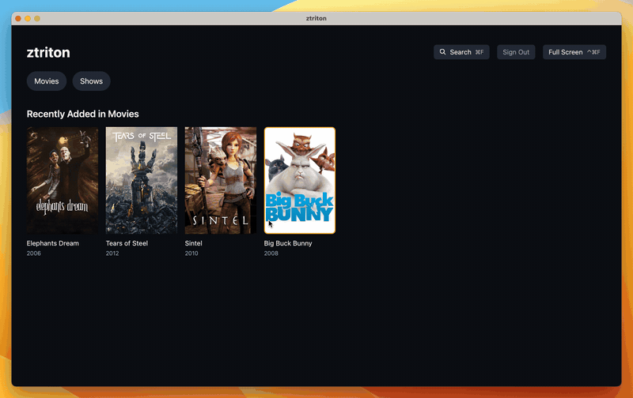

# ztriton



A native macOS Jellyfin client built with GPUI, with playback through libmpv.

- Sign in once; the session is kept in the macOS Keychain.
- Home, detail and player screens.
- Search movies, shows and episodes across all libraries as you type
  (`⌘F`, the **Search** button, or ztriton › Search…), with results grouped
  and filterable by type.
- Hardware-decoded video (VideoToolbox) rendered on the GPU via IOSurfaces
  drawn with Metal. Macs without an accelerated OpenGL renderer, such as
  macOS virtual machines, fall back to Apple's software renderer.
- Previous / next episode from the player.
- Subtitle picker, including sidecar files (e.g. `.srt`) stored next to the
  video on the server; the chosen subtitle is remembered.
- Playback resumes where it was left, even for watches too short for
  Jellyfin to save, and progress is reported back to the server.

## Requirements

- The app and DMG run on macOS 13 Ventura or later, with no mpv installed.
- To build: Rust 1.100 (`mise install`) and the Xcode command line tools.
  `cargo run`/`make test` link Homebrew's mpv 0.42+ (`brew install mpv`).
  `make app`/`make dmg` build libmpv 0.42 and its dependencies from source
  for macOS 13 (`scripts/build-libmpv.sh`, a few minutes the first time) and
  copy them into the app bundle, since Homebrew's libraries only run on the
  macOS version they were built for.

## Build & run

```sh
make install   # builds dist/ztriton.app, installs to ~/Applications
make app       # builds dist/ztriton.app only
make dmg       # builds dist/ztriton-<version>.dmg for releases
make vm-dmg    # builds the DMG inside a Tart macOS VM (VM=, BASE= to override)
make test      # unit + live-server tests
make bench     # CPU/memory/frame-rate benchmark while playing (needs a signed-in session)
make uninstall # remove the app; keeps the Keychain login and device id
```

Builds are signed with your Apple Development identity when one exists
(free Apple ID, Xcode › Settings › Accounts), so the Keychain stops asking
for your password after every rebuild. Override with `SIGN_IDENTITY`.

Live-server tests read `JELLYFIN_URL`, `JELLYFIN_USER` and `JELLYFIN_PASSWORD`
from the environment or from `.env` (git-ignored). Set it up once with
`cp .env.example .env`. Without it they skip, except the subtitle test,
which falls back to the app's saved login.

Sign in from the app. The session is stored in the macOS Keychain, and
preferences and resume positions are stored in
`~/Library/Application Support/ztriton/`.

## Player keys

| Key | Action |
| --- | --- |
| `space` | Play / pause |
| `←` `→` (`⇧` for 60s) | Seek 10s |
| `↑` `↓` | Volume |
| `m` | Mute |
| `a` | Cycle audio track |
| `s` | Cycle subtitles (or click **CC** to pick one) |
| `p` / `n` | Previous / next episode (or click ⏮ ⏭) |
| `f` | Fullscreen |
| `esc` | Close player |

`⌃⌘F` toggles full screen anywhere in the app, as does the button in the
top-right corner. Outside the player, `esc` or `⌫` goes back.

Verification screenshots, logs and benchmark results are written to `proof/`
(git-ignored).
